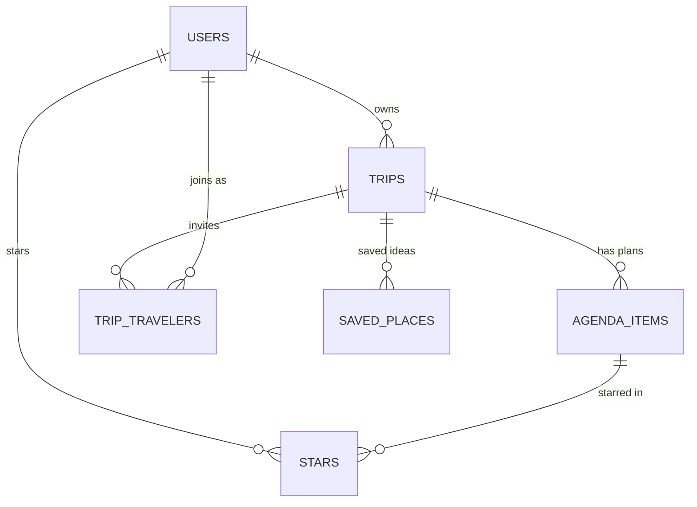

# RMS Rhone — Plan

> **Starting point:** RMS Rhone began as a Lovable prototype in August 2026. That earlier work is the repo history before Issue #1. It covers trips, a day-by-day itinerary, budget, saved ideas, documents, travelers and a map. This plan covers what I'm adding for the assignment. Every change from here on goes through an Issue, a branch and a pull request.

## 1. Pitch

I'm building **RMS Rhone**, a trip planner that works like a travel binder and a day planner at once. I'm building it because my trip details are scattered across email confirmations, Google Docs and Notes. When I'm actually traveling, I can never find the confirmation number, the reservation time, or how much the trip has cost so far.

**How often I'll use it:** several times a week while planning (I have trips coming up this semester and over winter break), and daily while I'm on a trip.

Live app: https://rmsrhone.lovable.app

## 2. Features (user stories, in build order)

The **main item** is a **plan**: one thing on a trip's agenda, like a flight, a hotel, a dinner reservation or a hike. Every plan belongs to a **trip**.

### Spine

1. **Sign up and login.** As a new visitor, I want to create an account with my email and a password, log in, and log out, so that my trips are private to me. *Done when:* the sign-up form creates a row in `users`, the login form gets me into `/trips`, a visible "Log out" button returns me to the landing page, and auth errors (wrong password, email taken, short password) appear as friendly messages.
2. **Data model.** As a traveler, I want my plans organized under trips, so that a flight to Lisbon and a dinner in Tokyo don't end up in the same list. *Done when:* `users`, `trips`, `plans` (`agenda_items`) and `stars` exist with the relationships in section 3, and row-level security means each user only sees trips they own or were invited to.
3. **Create / read / update / delete plans.** As a traveler, I want to add a plan (for example "Dinner at Taberna Sal Grosso, Restaurant, Oct 18, 20:00, $60"), see the list, open one plan's detail page, edit it, and delete it, so that my itinerary stays accurate. *Done when:* each plan has its own detail page at `/trips/:tripId/plans/:planId`, and deleting a plan or a trip asks "Are you sure?" first.
4. **Validation.** As a traveler, I want a friendly message when I forget something required, so that I don't save half-empty plans. *Done when:* a plan can't be saved without a **title** and a **category**, a trip can't be saved without a **name**, an end date can't come before the start date, and costs can't be negative. Each problem shows an inline message next to its field, not a browser pop-up.
5. **Stars.** As a traveler, I want to star the plans I can't miss (the sunset cable car, the restaurant I booked months ahead), so that I can see them all in one "Starred" view across every trip. *Done when:* a star button on each plan toggles a row in one shared `stars` table (user + plan), and a `/starred` page lists only my starred plans.
6. **Find things.** As a traveler, I want to search all my plans by keyword, filter by trip and category, and sort them (soonest first, newest added, most expensive), so that I can find "that ramen place" in seconds. *Done when:* an "All plans" page at `/plans` has a search box, a trip filter, a category filter and a sort menu.
7. **Dashboard.** As a traveler, I want a dashboard of my travel at a glance, so that I know how much I'm spending and where. *Done when:* `/dashboard` shows at least 3 stats (total plans, total spend, average cost per paid plan, busiest month) and a bar chart of spend by category.

### My 4 features

8. **Random pick.** As an indecisive traveler, I want a "Can't decide?" button on a trip's saved ideas that picks one unscheduled idea at random, so that I stop debating where to eat.
9. **CSV export.** As a traveler, I want to download a trip's plans as a CSV file (date, time, title, category, location, confirmation number, cost, status), so that I can share it or open it in Google Sheets.
10. **Calendar view.** As a traveler, I want a month calendar showing every plan from every trip on its date, so that I can see when trips overlap and which days are packed.
11. **Dark mode.** As a traveler checking my itinerary at night, I want a dark-mode toggle in Settings that the app remembers, so that the screen isn't blinding.

## 3. Database

The backend is Postgres (Lovable Cloud / Supabase). Primary keys are `uuid`. Tables I'm using or adding for the assignment:

| Table | Columns (type) | Notes |
|---|---|---|
| **users** (`auth.users` + `profiles`) | `id` uuid **PK**, `email` text, `full_name` text, `preferred_name` text, `home_airport` text, `created_at` date/time | Supabase Auth makes the `auth.users` row at sign-up, and a trigger creates the matching `profiles` row (`profiles.id` = `auth.users.id`). |
| **trips** | `id` uuid **PK**, `owner_id` uuid → users, `name` text (required), `primary_destination` text, `start_date` date, `end_date` date, `trip_type` text, `status` text, `budget_total` number, `currency` text, `archived` true/false, `created_at` date/time | One user owns many trips. |
| **plans** (`agenda_items`) | `id` uuid **PK**, `trip_id` uuid → trips, `title` text (required), `category` text (required, e.g. Flight / Hotel / Restaurant / Activity), `day_date` date, `start_time` time, `end_time` time, `location_name` text, `city` text, `confirmation_number` text, `cost_estimated` number, `cost_actual` number, `status` text (Idea / Reserved / Confirmed / Completed), `paid` true/false, `notes` text, `created_at` date/time | One trip has many plans. |
| **stars** *(new)* | `id` uuid **PK**, `user_id` uuid → users, `agenda_item_id` uuid → plans, `created_at` date/time; **unique** (`user_id`, `agenda_item_id`) | Junction table. One row means "this user starred this plan." |

**Relationships**
- users **1 → many** trips (`trips.owner_id`)
- trips **1 → many** plans (`agenda_items.trip_id`, deleting a trip deletes its plans)
- users **many ↔ many** plans, **through `stars`**
- *(already in place)* users **many ↔ many** trips through `trip_travelers` (invited travelers). Trips also have many `saved_places`, `documents`, `checklist_items` and `comments`.

**Security:** row-level security on every table. A user can read or change a trip and its plans only if they own the trip or are listed as one of its travelers. A user can only read, add or delete **their own** star rows.

## 4. Tests

1. **Data isolation.** *Given* User A has a trip called "Lisbon" with a plan "Dinner at Sal Grosso", and User B has signed up but has no trips, *when* User B asks the database for all trips and all plans, and then tries to edit and delete A's plan, *then* B gets back zero trips and zero plans, the edit and delete change nothing, and A's plan is still there when A looks.
2. **Dashboard stat.** *Given* three plans: a Hotel with actual cost $400, a Restaurant with estimated cost $60, and an Activity with no cost, *when* the dashboard computes its summary stats, *then* total plans = 3, total spend = $460 (actual cost wins over estimated), average cost per paid plan = $230, and the top spending category is Hotel.

## 5. Technologies

| Choice | Why |
|---|---|
| **Lovable** (app builder + hosting at rmsrhone.lovable.app) | I built the prototype there, and it publishes the live URL with one click. |
| **Claude Code** (coding agent) | It works on GitHub branches locally, so each feature becomes its own PR and I review the diff before merging. |
| **Lovable Cloud database (Supabase Postgres)** | Already connected to the app, and row-level security enforces "each user sees only their own data" in the database itself, not just in the UI. |
| **Supabase Auth, email + password** | Sign-up and login happen inside the app with no third-party account needed. Every account is a row in `auth.users`. |
| **TanStack Start + React + Tailwind + shadcn/ui** | This is what the prototype already uses. shadcn gives me accessible dialogs, including the "Are you sure?" one. |
| **Recharts** | Already installed, and it handles the dashboard bar chart. |
| **Vitest + PGlite** (tests) | Vitest is fast and works with Vite. PGlite runs a real Postgres in memory, so the isolation test checks the *actual* security policies without touching my live data. |
| **GitHub** (Issues, branches, PRs) | Required, and Lovable syncs `main` both ways, so merged PRs show up in the Lovable editor. |

## 6. Design

The look is warm and editorial, like a leather travel journal:
- **Colors:** cream background, near-black ink text, deep forest-green brand color, clay/sun accents. Dark mode flips to an ink background with cream text.
- **Type:** Fraunces serif for headings, a clean sans-serif for body text.
- **Style:** large rounded cards, soft shadows, photo covers, emoji category icons, plenty of white space. It should be mobile-friendly because I check it on my phone while traveling.
- **Inspiration:** **TripIt** for keeping every confirmation in one place, and **Notion Calendar / Google Calendar** for the visual hour-by-hour and month views.

## 7. Risks and cuts

- **Least sure I can build:** the **data isolation test**. It has to run the app's real Supabase migrations and row-level security policies against an in-memory Postgres, which means imitating Supabase's `auth.uid()` and roles. **Fallback:** test the same policies with a smaller hand-written schema.
- **Database changes on Lovable Cloud:** I can't apply migrations from my laptop, so the `stars` table has to be applied through Lovable while it's on the `feature/stars` branch.
- **What I'll cut first if I run out of time:** **Dark mode** (#11), then **Calendar view** (#10). Both are nice to have, and none of the spine features depend on them.
