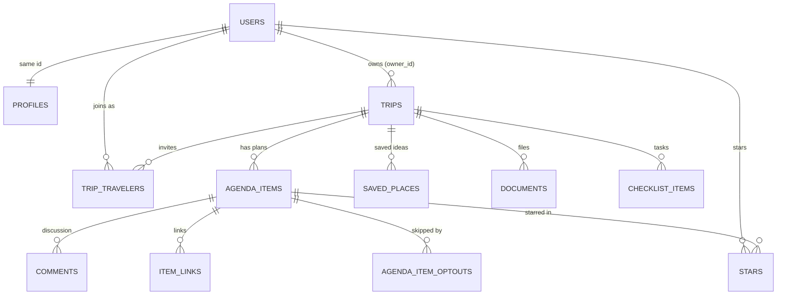

# RMS Rhone — Database schema

Postgres on Lovable Cloud (Supabase). Every table has **row-level security (RLS)** turned on. Primary keys are `uuid` unless noted. Types: **text**, **number**, **date**, **time**, **date/time** (timestamp), **true/false**, **list** (Postgres array), **json**.

## The four core tables

### `users` — `auth.users` + `public.profiles`
Supabase Auth creates one `auth.users` row when someone signs up. A database trigger (`handle_new_user`) then creates the matching `profiles` row with the same `id`.

| Column | Type | Notes |
|---|---|---|
| `id` | uuid | **PK**. Same value as `auth.users.id` |
| `email` | text | |
| `full_name`, `preferred_name` | text | |
| `home_airport`, `phone`, `avatar_url` | text | |
| `known_traveler_number`, `passport_number` | text | private travel details |
| `passport_expiry` | date | |
| `loyalty_programs` | json | list of `{kind, program, number}` |
| `frequent_flyer`, `hotel_loyalty`, `rental_car_programs` | text | older fields, superseded by `loyalty_programs` |
| `created_at` | date/time | |

RLS: each user can only read and edit **their own** profile (`id = auth.uid()`).

### `trips`
| Column | Type | Notes |
|---|---|---|
| `id` | uuid | **PK** |
| `owner_id` | uuid | the user who created it |
| `name` | text | **required** |
| `primary_destination`, `origin_city` | text | |
| `additional_destinations` | list of text | |
| `start_date`, `end_date` | date | |
| `trip_type` | text | Vacation, Business, … |
| `status` | text | Planning / Booked / In Progress / Completed |
| `budget_total` | number | |
| `currency` | text | default `USD` |
| `cover_image_url`, `notes` | text | |
| `archived`, `is_template` | true/false | |
| `created_at` | date/time | |

RLS: you can read or update a trip if you **own it** or are listed in `trip_travelers` (by user id or invited email). Only the owner can delete it.

### `agenda_items` — the **plans** (main item)
| Column | Type | Notes |
|---|---|---|
| `id` | uuid | **PK** |
| `trip_id` | uuid | **FK → trips.id** (deleting a trip deletes its plans) |
| `title` | text | **required** |
| `category` | text | **required**: Flight, Hotel, Restaurant, Activity, … |
| `status` | text | Idea / Planned / Reserved / Confirmed / Completed … |
| `day_date` | date | |
| `start_time`, `end_time` | time | |
| `time_zone` | text | |
| `location_name`, `address`, `city`, `country`, `map_url` | text | |
| `latitude`, `longitude` | number | for the map |
| `confirmation_number`, `booking_provider`, `booking_url` | text | |
| `reservation_name`, `reservation_email`, `reservation_phone` | text | |
| `contact_name`, `contact_company`, `contact_email`, `contact_phone`, `contact_website` | text | |
| `cost_estimated`, `cost_actual`, `transport_cost` | number | the dashboard uses actual cost if set, else estimated |
| `currency` | text | |
| `paid`, `shared_expense`, `completed` | true/false | |
| `refundable` | true/false | |
| `cancellation_deadline` | date/time | |
| `cancellation_policy`, `cancellation_notes` | text | |
| `paid_by` | text | traveler id |
| `participants`, `split_between` | list of text | traveler ids |
| `personal_for` | uuid | plan visible as one traveler's personal item |
| `transport_mode`, `transport_from`, `transport_to` | text | getting there |
| `transport_departure_time` | time | |
| `transport_duration_minutes`, `travel_next_minutes` | number | |
| `travel_next_mode`, `travel_next_note` | text | travel time to the next plan |
| `saved_place_id` | uuid | which saved idea it came from |
| `description`, `notes`, `image_url` | text | |
| `details` | json | category-specific extras (flight numbers, seats, …) |
| `sort_order` | number | |
| `created_at` | date/time | |

RLS: same rule as its trip. Trip members can read, add, edit and delete its plans.

### `stars` — junction table (users ↔ plans)
One row means "this user starred this plan." There is one table for everyone, not one per user. Added in Feature 5 (`drizzle/migrations/0001_create_stars_junction_table.sql`).

| Column | Type | Notes |
|---|---|---|
| `id` | uuid | **PK** |
| `user_id` | uuid | **FK → auth.users.id** (deleted with the user) |
| `agenda_item_id` | uuid | **FK → agenda_items.id** (deleted with the plan) |
| `created_at` | date/time | used to sort the Starred page |

Unique (`user_id`, `agenda_item_id`), so you can't star the same plan twice. Indexed on `user_id`.
RLS: you can only **see** and **remove** your own stars, and you can only **add** a star for yourself on a plan in a trip you belong to.

## Supporting tables (from the Lovable prototype)

| Table | Key columns | Relationship |
|---|---|---|
| `trip_travelers` | `id` PK, `trip_id` FK, `user_id` uuid (null until the invite is claimed), `name` text, `email` text, `role` text (default `editor`), `color` text | **Junction:** users ↔ trips (many-to-many). Invited travelers. |
| `saved_places` | `id` PK, `trip_id` FK, `name` text (required), `category` text, `meal` text, `priority` text (Must Do/Want to Do/Maybe), `city`, `address`, `url`, `notes` text, `estimated_cost` number, `tags` list, `scheduled` true/false | trips 1 → many saved ideas |
| `documents` | `id` PK, `trip_id` FK, `agenda_item_id` FK (nullable), `name`, `category`, `file_path`, `external_url`, `mime_type` text, `uploaded_by` uuid | trips 1 → many; plans 1 → many |
| `checklist_items` | `id` PK, `trip_id` FK, `title` text, `section` text, `completed` true/false, `due_date` date, `assigned_to` text, `sort_order` number | trips 1 → many |
| `comments` | `id` PK, `trip_id` FK, `agenda_item_id` FK (nullable), `author_id` uuid, `author_name` text, `body` text | trips 1 → many; plans 1 → many |
| `item_links` | `id` PK, `trip_id` FK, `agenda_item_id` FK, `label` text, `url` text | plans 1 → many |
| `agenda_item_optouts` | `id` PK, `trip_id` FK, `agenda_item_id` FK, `user_id` uuid, `note` text; unique (`agenda_item_id`, `user_id`) | **Junction:** "this traveler is skipping this plan" |

All supporting tables have `created_at` (date/time) and follow the trip-membership RLS rule. Exception: in `agenda_item_optouts`, a user can only add, edit or remove their **own** opt-outs.

## How the tables connect

In plain English:
- A **user** owns many **trips**. Other users join a trip through **trip_travelers** (many-to-many).
- A **trip** has many **plans** (`agenda_items`), saved ideas, documents and checklist items. Deleting a trip deletes all of them.
- A **plan** can have comments, links, documents and opt-outs.
- **Users ↔ plans is many-to-many through `stars`.** One user stars many plans, and a plan on a shared trip can be starred by many travelers.

## Compared with PLAN.md §3

- ✅ `users`, `trips` and `agenda_items` match the plan: one user has many trips, and one trip has many plans.
- ⚠️ **`trips.owner_id` has no foreign key to `auth.users`.** The prototype only stores the id. RLS still protects the data, but deleting a user wouldn't clean up their trips automatically. I noticed this while writing this file and left it unchanged, because adding the constraint is a risky change to a live database.
- ✅ `stars` matches the plan exactly: `id`, `user_id`, `agenda_item_id`, `created_at`, plus the unique pair. Unlike `trips.owner_id`, it **does** have real foreign keys.
